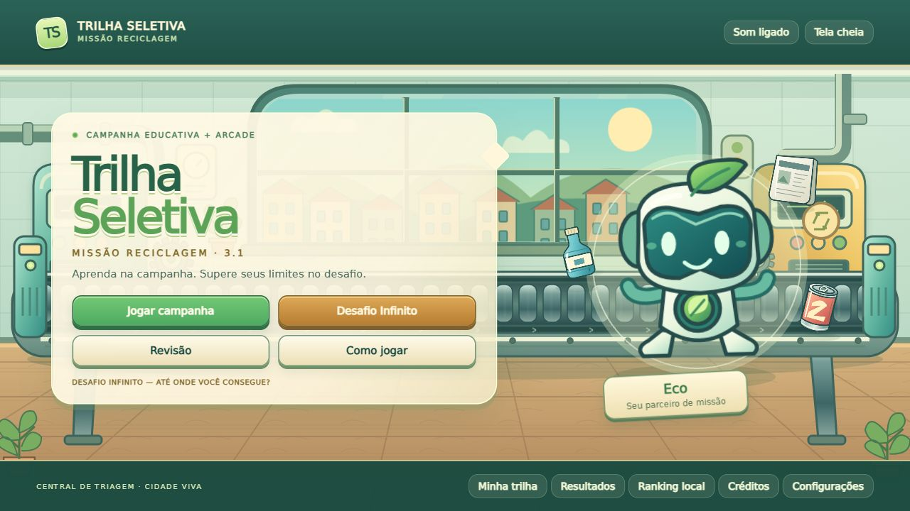
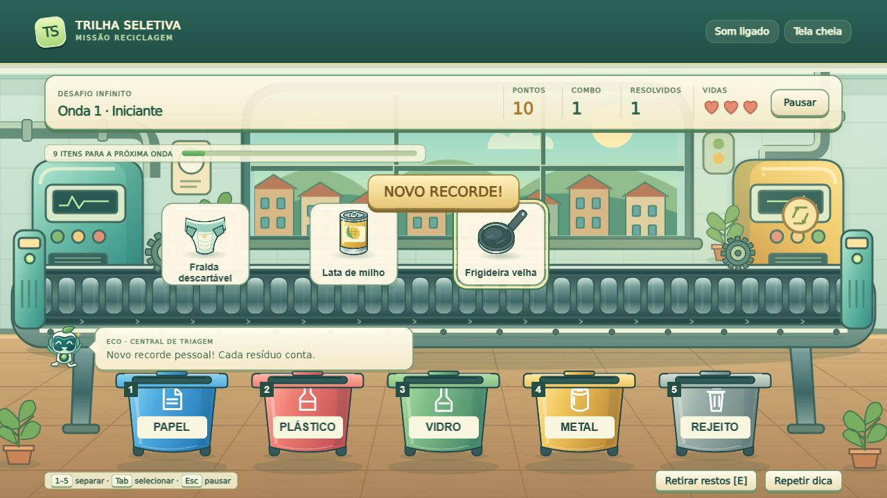
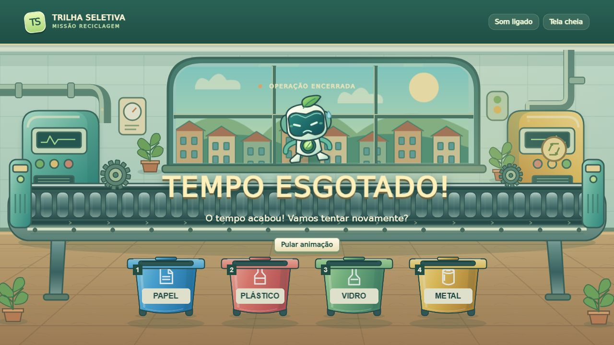
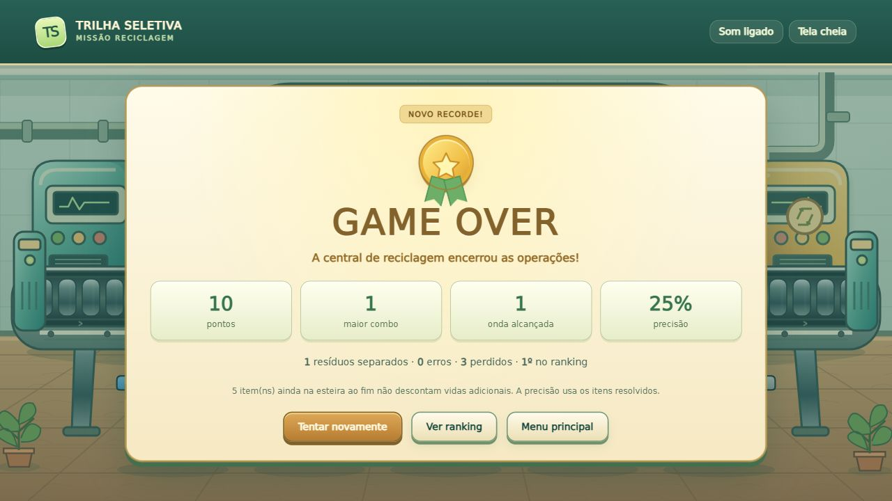
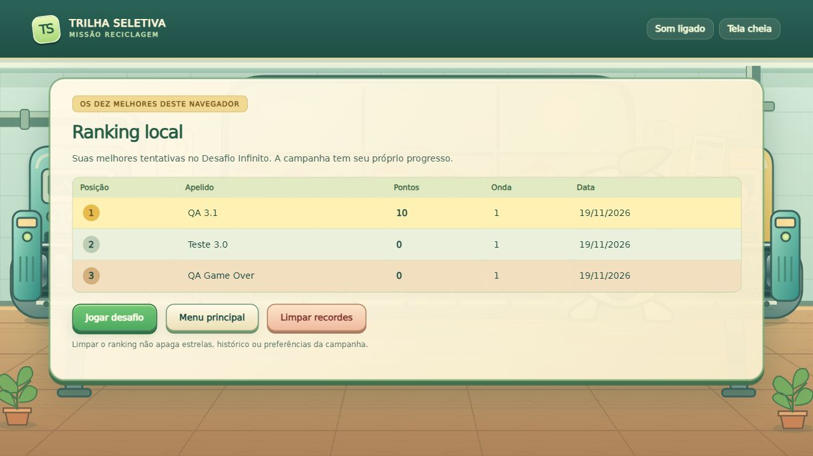
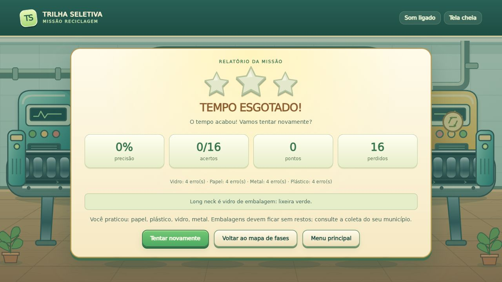
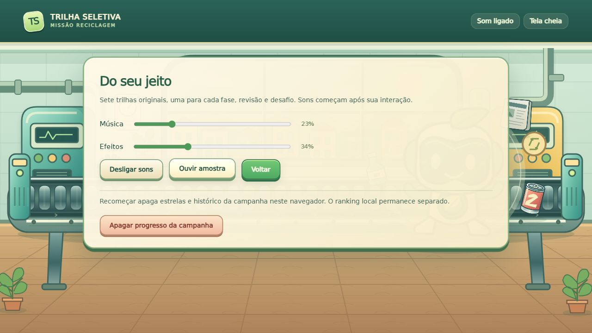

# GDD de Trilha Seletiva

Trilha Seletiva — Missão Reciclagem é um serious game de triagem em uma central de reciclagem fictícia. Este documento descreve o problema, as decisões de design, a implementação de navegador e o plano de validação. O tema é o número 03, Meio ambiente e cidade limpa, do Desafio P2 de Desenvolvimento de Jogos Digitais, Engenharia de Software, 7º período, Univassouras, professor Tiago Ruiz de Castro.

| Identificação | Informação |
|---|---|
| Dimensão e câmera | 2D, vista lateral da central de triagem |
| Gênero | Simulação arcade educacional para um jogador |
| Plataforma | Navegador desktop no Windows; mouse, teclado e toque |
| Versão do jogo | 3.1.0 |
| Tecnologia | JavaScript ES Modules, Phaser 3.90.0, Vite 6.4.6 e Vitest 4.1.12 |
| Código entregue | https://github.com/AmaralCharle/Trilha-seletiva ; projeto com fonte, assets e testes |
| Integrantes e matrículas | Pendente de informação do grupo; máximo de cinco integrantes |
| Vídeo de 1 a 3 minutos | Pendente de gravação e publicação pelo grupo |
| Data e local de entrega | A confirmar com o professor; a aula não estabelece valores |

## 1 O problema

### Problema em uma frase

Moradores iniciantes em coleta seletiva, ao separar embalagens e pequenos resíduos em casa antes da coleta, podem escolher o destino incorreto porque confundem o material ou a contaminação do objeto.

### Contexto e evidência

O recorte do público é uma hipótese de projeto, ainda sem entrevista ou observação local do grupo. As orientações de Vinhedo e da Secretaria de Saúde de São Paulo mostram que a separação exige distinguir materiais, retirar restos e reconhecer rejeitos. Elas fundamentam o conteúdo do jogo; não comprovam a frequência dos erros no público proposto. O teste externo deverá verificar essa hipótese antes de uma afirmação de impacto.

### O que já existe e por que não basta

Cartilhas e campanhas explicam destinos corretos e cuidados de preparação. O jogo acrescenta prática repetida, decisão sobre objetos diferentes e explicação imediata do erro. A hipótese é que essa prática favorece o reconhecimento; não se presume que substitua orientação da cooperativa ou do município.

## 2 Público-alvo

### Perfil do jogador

Estudantes a partir de aproximadamente 12 anos e moradores iniciantes em coleta seletiva, com leitura de português e familiaridade básica com mouse ou teclado. O grupo deverá convidar uma pessoa com esse perfil, de fora da equipe, para testar.

### Situação de uso

Atividade breve em computador escolar ou doméstico. Cada fase apresenta de 12 a 26 resíduos; as quatro últimas possuem relógio de 55 a 65 segundos antes de bônus e penalidades. A primeira fase e a revisão permitem aprender sem cronômetro. A jornada pode ser interrompida entre tentativas, pois o progresso é local.

### Barreiras

| Barreira proposta | Natureza da evidência | Resposta do jogo |
|---|---|---|
| Confundir aparência e material | Hipótese a verificar | Resíduos com silhuetas distintas, nome e retorno de classificação |
| Achar que todo papel é reciclável | Distinção presente nas orientações oficiais | Papéis contaminados e itens confundíveis nas fases avançadas |
| Achar que toda embalagem precisa de lavagem | Orientação municipal consultada | Preparação por retirada de restos, sem comando de enxágue universal |
| Desistir depois de um erro | Hipótese de usabilidade | Dicas de Eco, repetição e revisão sem cronômetro |

### Acessibilidade

As lixeiras combinam cor, nome e símbolo. As ações centrais têm alternativa de teclado. O retorno usa texto e imagem além de som; áudio pode ser desligado. O tutorial apresenta uma ação por vez. O layout se adapta à área disponível, com prioridade ao desktop. A acessibilidade integral por leitor de tela no canvas e a adequação para todas as limitações motoras não foram validadas.

## 3 Objetivo de impacto

### Depois de jogar o jogador será capaz de

- Identificar o material predominante dos resíduos do catálogo.
- Distinguir embalagens recicláveis de rejeitos como papel contaminado e cerâmica na convenção de coleta apresentada.
- Decidir quando retirar restos de uma embalagem e procurar a regra local para casos especiais.

### Hipótese de mudança

Se o jogador classifica resíduos, recebe explicações e pratica novamente seus erros, então poderá escolher destinos mais adequados na separação doméstica, porque exercita reconhecimento e correção em contextos variados. A transferência para resíduos físicos ainda precisa ser medida.

### Por que um jogo

A própria ação de encaminhar o objeto ao destino é o conteúdo praticado. O movimento da esteira exige atenção e priorização; as sequências de acertos oferecem retorno sobre consistência. A revisão reduz a pressão e concentra a prática nas dificuldades observadas.

## 4 Conceito do jogo

### Conceito em duas frases

O jogador trabalha com Eco, um pequeno robô instrutor, separando resíduos que chegam pela esteira de uma central de triagem. Cinco turnos introduzem novos materiais, rejeitos e preparação de embalagens, até uma operação com maior velocidade.

### Estilo e motor

A vista lateral 2D mantém o foco no reconhecimento e no destino dos objetos. Phaser 3 oferece atualização por tempo, entrada de ponteiro e teclado e renderização Canvas/WebGL em navegador; Vite organiza o desenvolvimento e gera uma distribuição estática. O projeto funciona sem backend, conta ou banco remoto e carrega seus recursos do próprio pacote.

| Campo | Definição |
|---|---|
| Jogadores | Um |
| Referências de design | Operação de esteira do original TrilhaSeletiva; prática espaçada e feedback imediato como decisões de design |
| Pilares | Reconhecer com clareza, aprender com cada tentativa, progredir por domínio |

## 5 Mecânica dinâmica e estética

| Mecânica | Dinâmica esperada | Estética pretendida | Ligação com o problema |
|---|---|---|---|
| Arrastar ou encaminhar por teclado | Observar e escolher destino | Controle e descoberta | A classificação é executada como ação |
| Resíduos na esteira com velocidade crescente | Priorizar sem perder a precisão | Atenção e desafio | Repetir reconhecimento em diferentes ritmos |
| Dica depois de erro | Comparar a decisão e o material | Segurança para tentar novamente | Corrigir a associação equivocada |
| Preparação de embalagens | Retirar restos antes do destino | Cuidado e competência | Separação depende também do estado do resíduo |
| Pontos por sequência e estrelas por precisão | Buscar consistência | Realização | Premiar acertos sustentados sem ocultar erros |
| Revisão baseada nos erros | Repetir os itens difíceis | Autonomia e domínio | Concentrar a prática na necessidade observada |

## 6 Regras e jogabilidade

### Ciclo central

| Etapa | Ação e retorno |
|---|---|
| Objetivo imediato | Identificar o próximo objeto antes que saia da área útil |
| Ação | Selecionar, preparar se necessário e encaminhar à lixeira |
| Retorno | Animação, texto explicativo, som opcional e atualização dos indicadores |
| Consequência | Acerto soma pontos; erro ou perda quebra a sequência e pode reduzir o tempo |
| Repetição | Concluir a fase, melhorar as estrelas ou revisar as dificuldades |

### Objetivos de curto médio e longo prazo

Nos próximos segundos, classificar o objeto selecionado. Na fase, atingir a meta com todos os resíduos contabilizados. Na jornada, concluir os cinco níveis e revisar os resíduos que ainda geram erros.

### Vitória derrota e encerramento

A precisão usa acertos divididos pelo total previsto da tentativa, inclusive itens perdidos e pendentes ao terminar o relógio. A tentativa encerra uma única vez, ao contabilizar o lote ou esgotar o tempo. A fase é aprovada somente se o resultado final atingir sua meta. Uma tentativa abaixo da meta pode ser repetida sem perda do progresso anterior. A quinta fase aprovada conclui a jornada principal.

| Regra | Valor e finalidade |
|---|---|
| Acerto | 10 pontos |
| Sequência | A partir do terceiro acerto consecutivo, cada acerto vale 20 pontos |
| Erro ou perda | Quebra a sequência; desconta 3 segundos quando há cronômetro |
| Bônus | A cada cinco acertos consecutivos, acrescenta 2 segundos quando há cronômetro |
| Tempo | Nunca fica abaixo de zero; a pausa interrompe sua contagem |
| Uma estrela | Meta da fase atingida e precisão abaixo de 90% |
| Duas estrelas | Meta atingida e precisão de pelo menos 90%, abaixo de 100% |
| Três estrelas | 100% de precisão |
| Resolução única | Uma identidade de resíduo só pode ser contabilizada uma vez |
| Reinício | Cria nova tentativa; a tentativa abandonada não concede estrelas |

### Desafio Infinito complementar

O arcade fica disponível desde o início, sem exigir conclusão da campanha. Começa com três vidas, 85 px/s, intervalo2,5 s e cinco categorias. Não possui relógio global nem lote final. Acerto vale10 pontos; a partir do terceiro seguido vale20 e a partir do décimo vale30. Erro, preparação incorreta ou objeto perdido custa uma vida e zera a sequência. Acerto não concede vida. A pontuação nunca fica negativa. O mesmo uid só pode ser resolvido uma vez.

A última vida encerra imediatamente a simulação. Pendentes restantes não descontam vidas e aparecem separadamente do total resolvido. A precisão é acertos/resolvidos, ou zero sem decisões. A tela GAME OVER informa pontuação, onda, acertos, erros, perdas, melhor combo, precisão e posição local quando houver. O jogador pode tentar novamente, abrir ranking ou retornar ao menu. O apelido tem até 15 caracteres, padrão Jogador. Dez registros locais são ordenados por pontos, combo, onda e data; limpar recordes exige confirmação e não altera a campanha. Abandono não entra no ranking.

### Apresentação dos resultados na versão 3.1

O domínio conclui a sessão uma única vez. ResultFlow salva em onStart e protege a apresentação contra duplicatas. A derrota congela geração e interação, reduz a iluminação, reage nas pequenas luzes e mostra Eco com expressão de erro. A introdução dura 1,75 s, pode ser pulada e conduz a um painel persistente. Navegar ou reiniciar cancela callbacks antigos. Game Over usa música original de 6,4 s sem loop; vitória usa vinheta própria. As vozes musicais são trocadas em sequência, sem simultaneidade.

Na campanha, falhar pelo prazo exibe TEMPO ESGOTADO e falhar na meta exibe DESAFIO NÃO CONCLUÍDO. O resultado mostra dica do objeto mais errado. Não há vidas nessas fases. Uma derrota não libera próxima etapa. O motor continua avaliando suas condições explícitas de aprovação, sem transformar toda ocorrência de prazo em derrota se a meta já foi cumprida.

### Controles

Arrastar o objeto e soltar na lixeira funciona como entrada principal. Também é possível clicar no item e depois no destino. As teclas de 1 a 5 escolhem as lixeiras disponíveis na ordem visual; Tab seleciona o próximo item, E retira restos da embalagem selecionada e Esc pausa ou retoma. Botões visíveis oferecem pausa, preparação e repetição da dica. Não é necessário identificar uma lixeira apenas pela cor.

### Pontuação e recursos

Pontos comunicam consistência e não compram vantagens. Tempo organiza a duração dos turnos cronometrados. Estrelas representam a precisão final da tentativa, e o melhor resultado salvo permanece disponível. Não há vidas pagas, moeda comercial ou consumíveis.

## 7 Progressão e dificuldade

| Fase | Conteúdo | Resíduos | Lixeiras | Velocidade | Intervalo | Tempo | Meta |
|---|---|---:|---:|---:|---:|---:|---:|
| 1 Papel ou plástico | Reconhecimento inicial | 12 | 2 | 70 px/s | 2,6 s | Sem relógio | 75% |
| 2 Vidro e metal | Ampliação de materiais | 16 | 4 | 95 px/s | 2,2 s | 60 s | 80% |
| 3 Nem tudo recicla | Rejeitos e confundíveis | 20 | 5 | 115 px/s | 1,9 s | 60 s | 80% |
| 4 Sujo contamina | Preparação de embalagens | 20 | 5 | 130 px/s | 1,8 s | 65 s | 80% |
| 5 Hora do rush | Combinação das habilidades | 26 | 5 | 160 px/s | 1,4 s | 55 s | 85% |

Os valores principais preservam a configuração original. A cena usa canvas lógico de 1280 × 720 e aproximadamente 1100 px de percurso útil, mais longo que a janela original de 960 px. Mantidas as velocidades, isso aumenta a tolerância antes de um item sair; não é uma comparação direta de dificuldade por velocidade isolada. A cena limita a seis itens simultâneos e suspende novas chegadas enquanto está cheia. O treino usa três itens a 45 px/s; a revisão não tem cronômetro e mantém um item parado por vez, sem perdas por borda. Essas escolhas favorecem reconhecimento e controle, mas ainda precisam de balanceamento com pessoas. O desbloqueio é sequencial: aprovação libera o nível seguinte, até o quinto. A revisão usa as dificuldades registradas e remove o limite de tempo e a perda por saída da esteira. Ela apresenta um item parado por vez para permitir reflexão. A última decisão errada ou perdida tem prioridade; uma resposta correta posterior reduz a prioridade daquele item, e a frequência histórica desempata. Essa mudança redistribui a prática sem comprovar domínio fora do jogo. Seu desempenho fica separado do desbloqueio da trilha.

### Ondas do arcade

A cada dez resíduos resolvidos a onda cresce, incluindo erros e perdas. O limite é seis objetos simultâneos e150 px entre novas chegadas. A geração suspende chegadas quando não há espaço, evitando sobreposição impossível.

| Onda | Velocidade px/s | Intervalo s |
|---|---|---|
| 1 | 85 | 2,5 |
| 2 | 95 | 2,3 |
| 3 | 110 | 2,1 |
| 4 | 125 | 1,9 |
| 5 | 140 | 1,7 |
| 6 | 155 | 1,5 |
| 7 | 170 | 1,4 |
| 8 | 185 | 1,3 |
| 9 | 200 | 1,2 |
| 10 | 210 | 1,1 |
| 11 em diante | cresce5 por onda até 240 | 1,1 |

As designações são Iniciante, Operador a partir da3, Especialista da5, Mestre da Triagem da7 e Lenda da Reciclagem da10. Confundíveis entram progressivamente após a onda2, e preparação após a3. Essa progressão ainda precisa de balanceamento com pessoas.

### Variação dos resíduos

Partidas normais usam nova entropia, amostragem balanceada e Fisher–Yates com restrições leves. Mantêm quantidades, categorias e cotas de confundíveis e preparação; evitam trincas de uma categoria quando há alternativas e reduzem ciclos curtos. Sementes fixas são usadas em testes. O tutorial acompanhado conserva uma sequência didática. A revisão prioriza a última dificuldade ainda não corrigida, com frequência histórica no desempate. Aleatoriedade não significa aumento comprovado de aprendizagem.

### Alavancas de dificuldade

Quantidade de resíduos, categorias permitidas, velocidade, intervalo, presença de confundíveis, necessidade de preparação, tempo e meta ficam em `src/config/levels.js`. Regras de pontuação ficam em `src/config/rules.js`. A largura do percurso, o limite de seis itens e os valores do treino e da revisão ficam na integração e na cena. Alterações futuras devem registrar motivo e dados usados no balanceamento.

### Primeiro minuto

Eco introduz a esteira, a seleção e o destino. O exercício orientado permite executar uma classificação, observar o retorno e repetir a orientação. A primeira fase limita os materiais a papel e plástico e não usa cronômetro; o risco de perder um objeto ainda ensina a acompanhar a esteira.

## 8 Motivação e ética

### Impulsos centrais

Desenvolvimento e realização aparecem nas estrelas e no desbloqueio; autonomia aparece na escolha de repetir e revisar; significado aparece na missão de separar resíduos de forma responsável. São propostas de motivação white hat, baseadas em domínio e escolha, sem recompensa comercial ou ameaça.

### Perfis de jogador

Realizadores podem buscar três estrelas e completar a trilha. Exploradores podem consultar dicas, reconhecer exceções e comparar os resíduos. A campanha não usa ranking competitivo. O arcade atende a busca por recordes com dez marcas locais para autossuperação; não há competição online nem modo social.

### Decisões éticas e cuidado com o tema

O jogo não utiliza anúncios, microtransações, recompensas enganosas ou mensagens de humilhação. Erros geram explicação. A revisão reduz a pressão temporal. Eco valoriza a ação de aprender e o cuidado com os profissionais da coleta. A central é fictícia: sua convenção não substitui a regra do município. Retirar restos não significa lavar toda embalagem, e vidro quebrado exige acondicionamento e identificação seguros.

## 9 Mundo narrativa e personagens

### Ambientação e narrativa

Uma cidade brasileira contemporânea mantém uma central de triagem ilustrada. O jogador inicia como aprendiz de Eco, assume turnos com materiais mais variados e conclui a operação principal ao aprovar o quinto nível. O conflito está em reconhecer materiais e evitar contaminação do lote. Não há inimigos humanos ou estereótipos sobre moradores e catadores.

| Entidade | Papel | Comportamento e aparência |
|---|---|---|
| Eco | Instrutor | Robô pequeno e amigável, com poses idle, happy, guide e error; orientações curtas e expressão contextual |
| Resíduo | Objeto da decisão | Ilustração e nome; deslocamento da esquerda para a direita |
| Lixeira | Destino | Cor, nome, símbolo do material e número de atalho; tampa ilustrada animada no descarte |
| Esteira | Organizador do ritmo | Movimento contínuo e saída que contabiliza perdas |
| Central | Contexto | Oficina clara com máquinas, tubulações, janela em arco, bairro ao fundo, vegetação e piso de madeira |

## 10 Level design

### Esboço funcional

```text
Indicadores da fase, pontos, sequência, tempo e progresso
                     Central de triagem
Entrada de resíduos -> Esteira e objetos -> Saída e perda
               Área de seleção e preparação
       Papel  Plástico  Vidro  Metal  Rejeito
               Eco e orientação contextual
```

O jogador inicia a observação junto à entrada, à esquerda. O objetivo é encaminhar cada objeto aos destinos abaixo antes da saída à direita. A dificuldade vem de movimento, simultaneidade, materiais confundíveis e preparação, sem obstáculos que escondam o nome do resíduo.

### Ritmo e posicionamento

A chegada espaçada dá tempo para reconhecer e agir. A progressão aumenta velocidade e frequência ao introduzir materiais. A tela de resultado e o mapa separam turnos, permitindo descanso. A revisão permite repetir decisões sem o relógio competitivo da trilha. As capturas reais da versão executada devem complementar este esboço no Anexo B.

## 11 Arte interface e áudio

### Direção de arte

A direção visual 2 adota uma oficina ecológica cartoon clara: paredes verde-menta, piso de madeira quente, janela em arco para o bairro, máquinas arredondadas e vegetação. Os resíduos usam silhuetas individuais, contornos, gradientes de material, reflexos e sombras. Eco tem quatro poses: repouso, celebração, orientação e erro. As lixeiras têm corpo e tampa separados, símbolo do material, rótulo e número. As cinco imagens de referência fornecidas orientaram apenas a direção criativa; não são assets redistribuídos nem imagens embutidas no jogo. As ilustrações SVG são originais do projeto, geradas em código com assistência de IA e carregadas localmente. A fonte DejaVu Sans é empacotada com seu aviso de licença. Não se depende de serviços externos para carregar recursos durante a partida.

### Telas e HUD

O fluxo inclui início, instruções e tutorial, mapa da trilha, jogo, pausa, resultado, revisão e resumo de progresso. O HUD comunica fase, pontos, tempo quando aplicável, sequência e quantidade resolvida. O resultado distingue aprovação e nova tentativa, exibe precisão e dificuldades, e permite repetir ou prosseguir. Configurações oferecem controle de áudio. A interface visual 2 utiliza painéis claros, botões com relevo, trilha conectada, estados de fase atual, concluída e bloqueada, estrelas vetoriais e medalha de conclusão. O HUD conserva pontos, sequência, itens e tempo ou precisão; Eco muda de expressão conforme o retorno. Os controles e as condições das mecânicas permanecem iguais.

### Áudio e assets

A apresentação reutiliza as ilustrações originais locais da versão 2, acrescentando piscar e pequenos gestos de Eco, indicadores em tubos e oscilação de transporte e sombra ao arrastar. Os arquivos SVG são rasterizados uma vez no carregamento. Movimento reduzido desativa efeitos decorativos.

Há sete trilhas de modo distintas: fases 1–5 em 92,108,116,124 e144 BPM, revisão74 BPM e arcade136 BPM. São composições instrumentais originais de síntese local, sem samples externos. Duas vinhetas adicionais sem repetição, gameover de 6,4 s e victory de 5,2 s, separam derrota e vitória. Doze efeitos cobrem seleção, arraste, acerto, erro, lixeira, combos, desbloqueio, vitória, derrota, recorde e onda.

AudioManager usa o Phaser, aguarda interação e mantém uma voz musical. Fade-out termina antes da próxima trilha; pausa preserva posição. Música e efeitos têm volumes independentes persistidos. Falha de áudio não bloqueia o jogo. No menu o fundo musical é silencioso. Os 21 WAVs são originais dedicados CC0; tools/generate-audio.mjs permite recriá-los. O inventário detalhado e licenças ficam em CREDITOS.md e AUDIO_3.md; DejaVu Sans preserva seu aviso de terceiros.

## 12 Arquitetura técnica

### Organização e componentes

A aplicação separa configuração, catálogo, domínio determinístico, armazenamento, cena Phaser e interface externa ao canvas. `src/main.js` coordena a navegação; `src/scenes/FactoryScene.js` desenha e atualiza a central; `src/systems/session.js` decide as regras; `src/systems/storage.js` salva e exporta resultados. `src/ui/art.js` contém as ilustrações originais de resíduos, Eco e lixeiras. `src/ui/factoryArt.js` define oficina, cidade e engrenagens; `src/entities/FactoryEnvironment.js` compõe as camadas e suas animações. A renderização carrega os SVGs em texturas no início; não redesenha o SVG completo em cada quadro. A descrição detalhada de dependências e funções consta em `docs/ARQUITETURA.md`.

### Componentes adicionados

InfiniteSession controla vidas, combo e ondas sem acumular um deck infinito. getDifficulty define parâmetros limitados. WasteSequenceGenerator fornece resíduos; classifyWaste concentra a classificação compartilhada com a campanha. leaderboard.js armazena os dez recordes em chave própria. AudioManager controla carregamento, reprodução e transições. ResultFlow coordena a apresentação e evita repetição da conclusão. arcade.js contém apenas marcação de telas, escapando apelidos.

### Estados ciclo tempo e colisão

A interface inicia uma tentativa com configuração e lote próprios. O ciclo de atualização do Phaser converte o delta de milissegundos para segundos, move os resíduos e avança o domínio. A soltura é comparada às regiões das lixeiras; uma saída da área útil registra perda. A pausa interrompe simulação, cronômetro, entrada de classificação e animações da cena. `FactoryEnvironment.update` mantém animações ambientais leves, como engrenagens, roletes, indicadores e movimento discreto do bairro; respeita a pausa e a preferência de movimento reduzido. Descartes usam animação de tampa, brilho e partículas; a cena limpa efeitos transitórios ao reiniciar ou voltar ao menu. O domínio impede contabilização duplicada e encerramentos concorrentes.

O fluxo complementar é menu, apresentação arcade, play, result-intro, arcade-result e ranking. A cena só movimenta ou classifica em play e fora de pausa. Game Over congela a fábrica e fica aberto até uma ação; reinício cria nova sessão, limpa efeitos e cancela temporizadores. A identidade de resíduos é controlada pelo domínio, não pela aparência.

### Dados e persistência

A tentativa armazena acertos, erros, perdas, sequência, pontuação, tempo e decisões por identidade. O progresso inclui maior nível liberado, melhores estrelas, preferências e histórico local. Não há envio de métricas para servidor. Exportar CSV permite ao grupo analisar tentativas. A indisponibilidade do armazenamento deve ser informada; apagar dados do navegador remove o progresso local.

O ranking usa trilha-seletiva-infinite-v1, separado de trilha-seletiva-v1 da campanha. São dez entradas com apelido, pontos, onda, combo, acertos, erros, perdas, precisão e data. Preferências antigas são migradas sem apagar histórico. Um Map de até seis pendentes e listas recentes limitadas permitem jogar por tempo indeterminado sem memória proporcional à duração. Falhas de armazenamento exibem aviso e mantêm a sessão em memória.

### Como executar

1. Instalar uma versão de Node.js compatível com a exigência declarada pelo projeto.
2. Extrair o projeto e abrir um terminal na pasta que contém `package.json`.
3. Executar `npm install` para instalar as dependências.
4. Executar `npm run dev` e abrir o endereço local indicado no terminal.
5. Para verificar as regras, executar `npm test`.
6. Para gerar a distribuição, executar `npm run build`; para servi-la localmente, executar `npm run preview`.

Os passos são iguais aos do README. A primeira instalação requer acesso à rede; a distribuição gerada leva os recursos de execução e não usa CDN. Navegador e hardware de teste, desempenho medido e resultados executados são registrados apenas depois de verificação real, em `docs/TESTES.md`.

## 13 Rastreabilidade do GDD ao código

A tabela foi conferida por inspeção dos arquivos da reconstrução. “Implementado” indica código presente; não equivale à validação externa de usabilidade. A execução e os limites de verificação ficam na seção 14 e no relatório técnico.

| Regra ou mecânica | Seção | Arquivo | Classe ou função | Situação |
|---|---|---|---|---|
| Catálogo de 27 resíduos e dicas | 5, 6 | src/data/catalog.js | CATALOG, LOCAL_NOTICE | Implementado |
| Cinco fases com quantidade, velocidade, intervalo, tempo e meta | 7 | src/config/levels.js | LEVELS | Implementado |
| Cores, nomes e símbolos dos destinos | 2, 6 | src/config/levels.js; src/ui/art.js; src/scenes/FactoryScene.js | BINS; binBodySVG; FactoryScene.createBin | Implementado; desenho, rótulo e número |
| Ordem balanceada e presença de confundíveis e preparação | 5, 7 | src/systems/session.js | buildDeck | Implementado |
| Pontos 10 e multiplicador a partir do terceiro acerto | 6 | src/config/rules.js; src/systems/session.js | RULES; Session.resolve | Implementado |
| Penalidade de 3 s e bônus de 2 s a cada cinco acertos | 6 | src/systems/session.js | Session.resolve, Session.miss | Implementado |
| Retirada de restos antes de classificar quando exigida | 5, 6 | src/scenes/FactoryScene.js; src/systems/session.js | FactoryScene.prepare; Session.resolve | Implementado |
| Resolução única e bloqueio de ação pausada ou encerrada | 6 | src/systems/session.js | Session.canResolve, Session.resolve, Session.miss | Implementado |
| Movimento por delta e item que sai da esteira | 5, 6 | src/scenes/FactoryScene.js | FactoryScene.update | Implementado |
| Limite de seis objetos e controle de chegada | 7 | src/scenes/FactoryScene.js | FactoryScene.update, FactoryScene.spawn | Implementado |
| Arrastar, clicar em objeto e destino, teclas 1–5 e Tab | 6 | src/scenes/FactoryScene.js | FactoryScene.create, FactoryScene.classify, FactoryScene.start | Implementado |
| Preparação com E | 6 | src/scenes/FactoryScene.js | FactoryScene.create, FactoryScene.prepare | Implementado |
| Precisão sobre lote total e contabilização de pendentes | 6 | src/systems/session.js | Session.finish | Implementado |
| Relógio limitado a zero e encerramento único | 6 | src/systems/session.js | Session.tick, Session.checkEnd, Session.finish | Implementado |
| Meta, aprovação e estrelas | 6, 7 | src/systems/session.js | Session.finish | Implementado |
| Tutorial com três itens e repetição da orientação | 7 | src/main.js | help, start, actions.hint | Implementado |
| Mapa e desbloqueio progressivo | 7 | src/main.js; src/systems/storage.js | map; saveAttempt, loadProgress | Implementado |
| Revisão sem cronômetro e priorização pela última decisão errada ou perdida, com frequência histórica no desempate | 5, 7 | src/main.js; src/systems/session.js | start; buildDeck | Implementado |
| Pausa, Esc, retomada e pausa quando a página fica oculta | 6, 12 | src/main.js; src/systems/session.js; src/scenes/FactoryScene.js | pause, resume, visibilitychange; Session.tick; FactoryScene.update | Implementado |
| Reinício e abandono sem recompensa | 6 | src/main.js; src/systems/storage.js | start, actions.restart, actions.abandon; saveAttempt | Implementado |
| Feedback, partículas e sons opcionais | 5, 11 | src/main.js; src/scenes/FactoryScene.js | feedback, fx; FactoryScene.classify, animateBin, feedbackParticles | Implementado |
| Resultado, próxima fase e conclusão da jornada | 6, 9, 11 | src/main.js | finish, actions.next, stats | Implementado |
| Histórico, erros por objeto e categoria e métricas | 12, 14 | src/systems/session.js; src/systems/storage.js | Session.finish; saveAttempt | Implementado |
| Exportação CSV | 14 | src/systems/storage.js; src/main.js | exportCSV; actions.export | Implementado |
| Áudio, volume e tela cheia quando suportada | 2, 11 | src/main.js; src/systems/storage.js | settings, fx, actions.sound, actions.fullscreen; saveSettings | Implementado |
| Reset e aviso de armazenamento indisponível | 12 | src/systems/storage.js; src/main.js | resetProgress, loadProgress, persist; render, toast | Implementado |
| Ilustrações locais e erro de carregamento | 11, 12 | src/ui/art.js; src/scenes/FactoryScene.js; src/main.js | itemSVG, ecoPoseSVG, binBodySVG, binLidSVG; FactoryScene.preload; asset-error | Implementado |
| Oficina, cidade e engrenagens vetoriais | 9, 11 | src/ui/factoryArt.js | factorySVG, citySVG, gearSVG | Implementado por inspeção |
| Camadas ambientais e movimento discreto | 9, 11, 12 | src/entities/FactoryEnvironment.js | FactoryEnvironment.constructor, showHero, update | Implementado por inspeção |
| Poses contextuais de Eco | 9, 11 | src/ui/art.js; src/main.js | ecoPoseSVG; eco, feedback | Implementado por inspeção |
| Tampas e resposta visual dos destinos | 6, 11 | src/scenes/FactoryScene.js | createBin, animateBin, feedbackParticles | Implementado por inspeção |
| Limpeza de efeitos ao reiniciar ou sair | 6, 12 | src/scenes/FactoryScene.js | clearEffects, transient, destroyEffect, start, showMenu | Implementado por inspeção |
| Preferência de movimento reduzido | 2, 11 | src/entities/FactoryEnvironment.js; src/scenes/FactoryScene.js; src/styles.css | FactoryEnvironment.update; animateBin, feedbackParticles; prefers-reduced-motion | Implementado por inspeção |
| Estrelas, trilha e medalha da interface | 7, 11 | src/main.js; src/styles.css | starPath, stars, medal, map, finish, stats | Implementado por inspeção |
| Fonte local redistribuída com aviso | 11, 16 | public/assets/DejaVuSans.ttf; public/assets/LICENCA_DejaVu.txt; src/styles.css | @font-face Local | Empacotado; licença preservada |

### Rastreabilidade da evolução 3 e do encerramento

| Regra ou mecânica | Seção | Arquivo real | Classe ou função | Situação |
|---|---|---|---|---|
| Classificação comum aos dois modos | 5, 6 | src/systems/classification.js | classifyWaste | Implementado |
| Embaralhamento com sementes e preservação de cotas | 6, 7 | src/systems/sequence.js; src/systems/session.js | fisherYates; constrainCategoryOrder; buildDeck | Implementado |
| Geração contínua com histórico recente limitado | 6, 7 | src/systems/sequence.js | WasteSequenceGenerator.next | Implementado |
| Três vidas, resolução única e combos 10/20/30 | 6 | src/systems/infiniteSession.js | InfiniteSession.resolve; miss; loseLife | Implementado |
| Ondas a cada dez decisões e limites de velocidade | 7 | src/config/infinite.js; src/systems/infiniteSession.js | getDifficulty; completeDecision | Implementado |
| Seis simultâneos e espaçamento mínimo 150 px | 6, 7 | src/scenes/FactoryScene.js; src/systems/infiniteSession.js | update; nextItem | Implementado |
| Precisão do arcade só sobre resolvidos | 6 | src/systems/infiniteSession.js | precision; finish | Implementado |
| Ranking local de dez sem alterar a campanha | 6, 12 | src/systems/leaderboard.js | loadLeaderboard; saveInfiniteResult; clearLeaderboard | Implementado |
| Apelido limitado e escapado na interface | 6, 12 | src/systems/leaderboard.js; src/ui/arcade.js | normalizeNickname; escapeHTML | Implementado |
| Vidas, ondas e aviso de recorde no HUD | 6, 11 | src/main.js; src/ui/arcade.js | startInfinite; updateHUD; waveBanner; hearts | Implementado |
| Sete músicas de modo e dois resultados sem loop | 11 | src/systems/AudioManager.js; src/data/audioManifest.js | preloadAudio; playMusic; pump | Implementado |
| Volumes, gesto, pausa e nenhuma música sobreposta | 11, 12 | src/systems/AudioManager.js; src/systems/storage.js | unlock; fadeOut; pause; resume; setSettings; saveSettings | Implementado |
| Síntese reprodutível de 21 WAVs locais | 11, 16 | tools/generate-audio.mjs | addTone; drum; wav | Implementado |
| Encerramento único, cancelamento e pular introdução | 6, 11 | src/systems/ResultFlow.js; src/main.js | start; skip; cancel; defeatIntro | Implementado |
| Fábrica congelada, iluminação e reação das luzes | 9, 11 | src/scenes/FactoryScene.js | presentDefeat; clearShutdown; update | Implementado |
| Derrotas da campanha e dica contextual sem desbloqueio | 6, 11 | src/main.js; src/systems/session.js | finish; finishCampaign; Session.finish | Implementado |
| Piscar, gestos e transporte leve | 9, 11 | src/ui/art.js; src/entities/FactoryEnvironment.js; src/scenes/FactoryScene.js | ecoPoseSVG; update | Implementado |

## 14 Testes e validação

### Validação técnica da versão 3.1

Foram aprovados 62 testes em 8 arquivos com Vitest 4.1.12. Os novos casos cobrem variação com sementes, cotas e categorias, 300 amostras de geração, 1400 decisões no arcade, combos exatos, vidas, duplicatas, limites de onda, memória limitada, ranking e isolamento da campanha, migração de áudio, uma voz musical, pausa, arquivos reais e transições de resultado idempotentes. O teste automatizado não equivale a uma passagem manual de todas as ondas ou validação com jogadores.

No navegador, a evolução 3 mostrou início do arcade, acerto de 10 pontos, aviso de recorde, pausa, game over após três perdas, ranking com apelido e persistência após recarregar. Os volumes23%/34% e silêncio geral foram preservados. A versão 3.1 recebeu teste específico da tela GAME OVER; as demais observações e limites de cada rodada estão em TESTES.md. Não foi medida qualidade auditiva por especialistas nem FPS sustentado.

Na correção 3.1, a tentativa arcade testada terminou com 10 pontos, combo 1, onda 1, um acerto e três perdas, precisão 25%, primeiro lugar local. O botão Pular animação foi acionado e o resultado ficou aberto até a escolha. Reiniciar restaurou três vidas e zero pontos. Uma derrota por prazo na fase 2 apresentou TEMPO ESGOTADO, 16 perdas e dica; o histórico passou de 3 para 4 tentativas, sem duplicação, e as estrelas anteriores foram preservadas. A fase 3 continuou bloqueada. Esses testes foram operados pelo assistente e não representam pessoas externas.

### Evidências técnicas anteriores

Na versão 2.0.0, foram executados 29 testes automatizados em quatro arquivos com Vitest 4.1.12: os 26 testes de domínio e persistência foram preservados e três testes de contrato dos assets foram acrescentados. Eles verificam ilustrações distintas para os 27 resíduos, quatro poses de Eco, separação entre corpo e tampa das lixeiras, camadas locais do cenário e codificação de Unicode. Os testes de contrato não substituem a inspeção visual da arte. O build de produção passou novamente após os ajustes finais. A distribuição foi servida na porta 4173: menu e cenário renderizaram, e os logs filtrados desse endereço não apresentaram erros observados.

No navegador integrado baseado em Chromium, foi completada manualmente a fase 1 com 12 acertos em 12 itens, 100% de precisão, 220 pontos, três estrelas e nenhuma perda; o botão de próxima etapa apareceu. O tutorial foi concluído com três acertos e 40 pontos. Foram observados arraste do jornal até PAPEL, classificação pelas teclas 1 e 2 e bloqueio de classificação durante a pausa, com retomada posterior. Foram observados menu, trilha e revisão com cinco lixeiras em 960 × 540; menu, jogo e resultado em 1280 × 720; e menu em 1600 × 900. Em largura menor, a faixa decorativa do menu foi ocultada e a altura mínima do HUD ajustada para evitar sobreposição com rodapé e missão. As capturas do anexo usam 1280 × 720. Esses resultados técnicos foram obtidos durante a verificação do software; não são dados de participante externo.

A verificação anterior da primeira versão registrou também download do CSV, preservação de preferência de som e tentativa após recarregar, reinício, abandono e abertura da distribuição de produção. Esses registros são históricos, identificados em `docs/TESTES.md`, e não constituem por si só repetição desses casos na apresentação nova. Chrome e Edge nativos não foram testados. A jornada das cinco fases permanece coberta pelo domínio automatizado, sem uma passagem manual completa pelas cinco fases no navegador. O acompanhamento da atualização visual está em `docs/VISUAL_2.md`.

### Teste com pessoa externa

Pendente. Convidar pelo menos uma pessoa com o perfil definido, explicar apenas o objetivo geral e observar a sessão sem interferir. Registrar perfil, ponto de dificuldade, decisão de melhoria e tentativa de repetição, sem nome do participante. O grupo deverá completar esta seção depois da observação; nenhum participante ou resultado é presumido.

| Métrica | Tipo | Registro | Valor observado |
|---|---|---|---|
| Erros e perdas por categoria | Comportamento | Histórico de cada tentativa | Pendente de teste com público |
| Tempo médio de decisão | Comportamento complementar | Intervalo entre aparição e resolução | Pendente de teste com público |
| Precisão e erros por minuto | Resultado dentro do jogo | Comparação de tentativas da mesma fase | Pendente de teste com público |
| Classificação de resíduos físicos ou imagens novas | Resultado fora do jogo | Atividade posterior sem dicas | Ainda não implementada no software; aplicação pelo grupo |

### Critério de sucesso

Antes do teste, propõe-se comparar duas tentativas da mesma fase: redução de erros por minuto e precisão final de pelo menos 90%. Esse é um critério de desempenho no jogo, sujeito a revisão pelo grupo antes de coletar dados. Para afirmar impacto fora dele, aplicar uma classificação posterior com itens novos e registrar sua precisão. Repetir o mesmo lote pode refletir memorização; não prova aprendizagem geral.

### Defeitos conhecidos

O relatório técnico deve separar defeitos reproduzíveis de limitações do escopo. Ainda não há validação externa, auditoria integral de acessibilidade, medição sustentada de FPS ou teste em computadores de laboratório. As três resoluções observadas não garantem adequação a todos os aparelhos, toque físico ou navegadores; Chrome e Edge nativos permanecem sem teste. O registro atualizado está em `docs/TESTES.md`.

## 15 Riscos limitações e próximos passos

### Como alguém burla o jogo

A pessoa pode decorar atalhos ou repetir objetos sem transferir o reconhecimento para situações novas. O embaralhamento reduz a exploração de uma ordem fixa, sem eliminar a possibilidade de acertos por tentativa. Estrelas usam precisão sobre o lote total, e o domínio bloqueia eventos repetidos para a mesma identidade; isso reduz exploração por cliques duplicados. Um bom resultado permanece uma medida de desempenho no jogo, não uma certificação de comportamento ambiental.

### Risco de mensagem errada

Cores de lixeira não garantem que o município aceite todo objeto daquele material. Preparação não deve ensinar lavagem obrigatória, e rejeito no modelo simplificado não resolve todas as rotas de destinação. O conteúdo explicita variação local; resíduos perigosos, eletrônicos, lâmpadas e outras rotas especiais não são classificados como lixo comum por analogia com o catálogo.

### O que ficou de fora

Não há multiplayer, conta online, ranking global, sincronização entre aparelhos nem integração com calendários municipais. Música licenciada externa não é necessária para esta versão. Vídeo acadêmico, participantes, observação externa e comprovação de transferência de aprendizagem dependem do grupo.

### Próximos passos

Com mais um mês, realizar testes com público, ajustar a legibilidade e o ritmo por dados, validar o catálogo com uma cooperativa local e medir reconhecimento de novos objetos. Ampliar acessibilidade por tecnologia assistiva e perfis de dificuldade deve acompanhar a validação, sem ampliar o escopo antes de resolver os problemas observados.

## 16 Equipe uso de IA e créditos

### Divisão do trabalho

| Integrante | Matrícula | Contribuição |
|---|---|---|
| A informar pelo grupo | A informar | Registrar contribuição real e arquivos correspondentes |

Nenhum nome, matrícula ou distribuição de trabalho foi inventado. Cada integrante deverá saber explicar as regras, a separação do código e as decisões de design.

### Uso de IA e ferramentas

A evolução 3 e a correção 3.1 também utilizaram Codex/OpenAI para gerador aleatório, sessão arcade, ranking, composição algorítmica, controle de áudio, transição de resultado e testes. As composições não contêm samples de terceiros e os arquivos são gerados localmente. Essa declaração não substitui a revisão humana nem comprova autoria ou contribuições pessoais de integrantes ainda não informados.


Codex, da OpenAI, foi utilizado para analisar o projeto Pygame fornecido, propor o redesign, gerar código JavaScript, ilustrações vetoriais programáticas, testes automatizados e rascunhos de documentação. Na atualização visual 2, a assistência incluiu os 27 resíduos, quatro poses de Eco, lixeiras com tampas separadas, oficina, cidade, engrenagens e interface. As cinco referências visuais serviram como direção criativa e não foram copiadas para os assets. DejaVu Sans é um recurso de terceiros redistribuído com o aviso Bitstream Vera/DejaVu preservado em public/assets; não é arte gerada por IA. Os arquivos gerados estão no projeto de navegador. A revisão humana do grupo e as alterações feitas por seus integrantes devem ser registradas antes da entrega; o uso de IA não substitui essa responsabilidade. Vite, Phaser e Vitest são dependências de terceiros com suas licenças próprias.

### Referências

- Tiago Ruiz de Castro. Aula Desafio P2, 12/11/2026, e Modelo GDD Desafio P2, materiais fornecidos pelo usuário. Fundamentam a estrutura e os critérios acadêmicos.
- Prefeitura de Vinhedo. Coletas seletiva e orgânica. https://www.vinhedo.sp.gov.br/portal/secretarias-paginas/165/coletas-seletiva-e-organica/ . Orienta retirar excesso de resíduos e acondicionar vidros para evitar acidentes.
- Secretaria de Saúde do Estado de São Paulo. Coleta seletiva. https://saude.sp.gov.br/resources/centro-pioneiro-em-atencao-psicossocial-ajje/homepage/downloads/outros-assuntos/coleta_seletiva.pdf . Referência de materiais e rejeitos, com limitações locais.
- Phaser. Documentação oficial. https://docs.phaser.io/ . Referência do motor.
- Projeto TrilhaSeletiva em Python e Pygame, fornecido no ZIP pelo usuário. Origem das cinco fases e do catálogo; autoria e licença não presumidas.

## Anexo A Trechos centrais

Como o projeto utiliza código de texto, grafos de motor visual não se aplicam. Os trechos abaixo foram extraídos dos arquivos da reconstrução.

### Resolução única

`src/systems/session.js`, `Session.canResolve`: bloqueia índice inválido, ação repetida e resolução durante a pausa ou depois do fim.

```javascript
canResolve(uid) {
  return !this.paused && !this.finished && Number.isInteger(uid)
    && uid >= 0 && uid < this.deck.length && !this.resolved.has(uid);
}
```

### Classificação e preparação

A mesma função em src/systems/classification.js é usada pelas sessões da campanha e do arcade.

```javascript
export function classifyWaste(item, choice, prepared = false) {
  if (!item || choice !== item.category)
    return { ok: false, reason: 'category' };
  if (item.needsPrep && !prepared)
    return { ok: false, reason: 'preparation' };
  return { ok: true, reason: 'correct' };
}
```

### Precisão final

`src/systems/session.js`, `Session.finish`: o lote inteiro é o denominador, depois que as ocorrências pendentes foram registradas como perdas.

```javascript
for (let uid = 0; uid < this.deck.length; uid++)
  if (!this.resolved.has(uid)) this.recordMiss(uid);
this.finished = true;
const precision = this.deck.length ? this.correct / this.deck.length : 0;
```

## Anexo B Capturas reais

As imagens a seguir foram capturadas durante a implementação3.0 e a correção 3.1 no navegador integrado. Os apelidos QA identificam tentativas técnicas do assistente, sem pesquisa com pessoas.



Figura B1. Campanha, revisão, arcade e configurações preservando a identidade cartoon.



Figura B2. HUD do arcade com pontos, combo, vidas e cinco destinos; aviso de recorde após um acerto.



Figura B3. Eco reage ao prazo encerrado e o jogador pode pular a apresentação. Não há vidas na campanha.



Figura B4. Resultado persistente após a última vida, com precisão dos resolvidos, onda, combo e três opções funcionais.



Figura B5. Marca de 10 pontos à frente das marcas de zero; dados específicos deste navegador de teste.



Figura B6. Tempo esgotado, 16 perdas, dica educativa e retorno ao mapa, sem avanço após derrota.



Figura B7. Volumes separados e silêncio geral, com preferências preservadas após recarregar.

## Pendências para a entrega acadêmica

O grupo deve preencher integrantes e matrículas, confirmar prazo e destino da entrega, registrar pelo menos um teste externo, revisar a declaração de IA, gravar um vídeo de 1 a 3 minutos com link acessível e conferir os anexos. Essas pendências não impedem o uso do jogo, mas impedem declarar a entrega acadêmica totalmente concluída.
